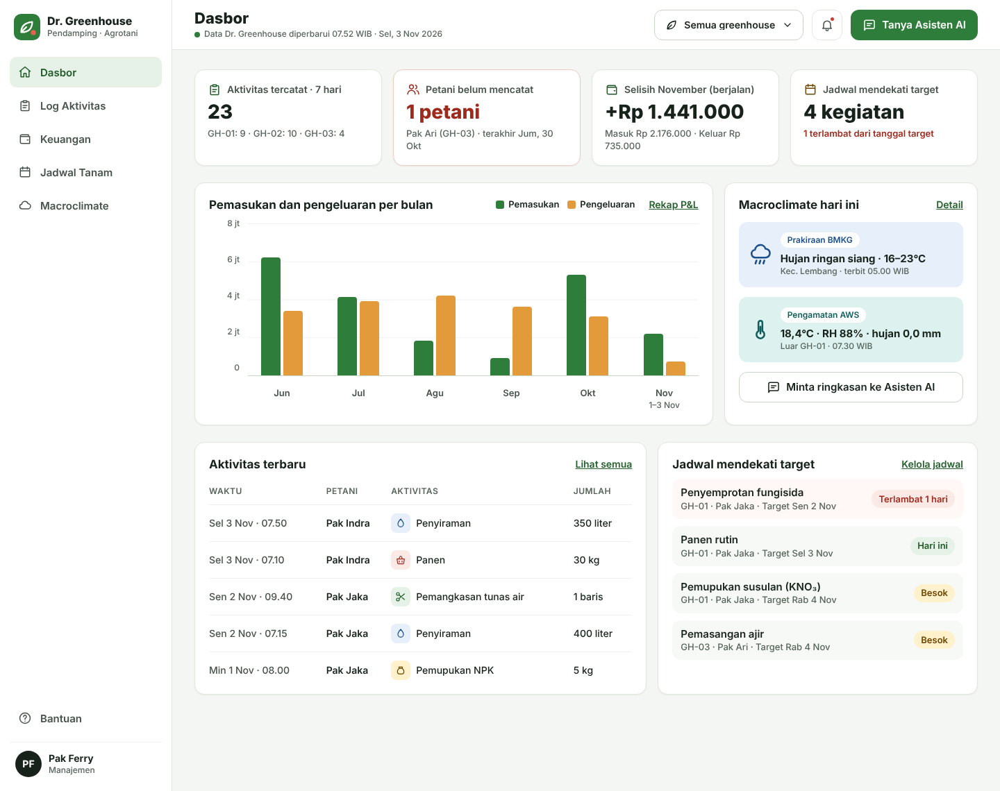

# Dr. Greenhouse Pendamping

Antarmuka pendamping untuk Dr. Greenhouse (Asosiasi Tomat Beef Agrotani, Cibodas, Lembang). Proyek Capstone 2026, S1 Sistem Informasi.

Tahap saat ini: **Dasbor Manajemen** sudah dibangun mengikuti mockup (M01 desktop, M07 ponsel) dengan data contoh. Halaman lain masih halaman sementara sambil menunggu hasil wawancara.

- Kebutuhan produk: [PRD.md](PRD.md) (sementara, belum divalidasi)
- Analisis fitur dan panduan wawancara: [docs/analisis-fitur-dan-wawancara.md](docs/analisis-fitur-dan-wawancara.md)
- Mockup rujukan: [docs/mockup/](docs/mockup/)



## Menjalankan

Butuh Node.js 18 atau lebih baru.

```bash
npm install
npm run dev      # buka http://localhost:5173
npm run build    # hasil di folder dist/
```

## Struktur

```
src/
  App.tsx              rute halaman dan filter greenhouse
  config.ts            saklar fitur (Asisten AI bisa dimatikan di sini)
  components/          Layout (sidebar, topbar, navigasi bawah), grafik, ikon
  pages/Dasbor.tsx     dasbor manajemen
  pages/Stub.tsx       halaman sementara untuk fitur lain
  data/types.ts        tipe data
  data/mock.ts         data contoh (sama dengan mockup, hari ini = Sel, 3 Nov 2026)
  data/api.ts          satu pintu masuk data; ganti di sini saat API siap
  data/format.ts       format Rupiah, tanggal, dan jam WIB
  styles/global.css    token warna dan gaya dari mockup
```

## Catatan
- Sumbu grafik keuangan dihitung dari data (kelipatan Rp 2 jt), jadi puncaknya 8 jt, bukan 6 jt seperti di mockup. Di mockup, batang Juni (Rp 6,2 jt) melewati garis 6 jt.
- Asisten AI diturunkan prioritasnya. Tombolnya tetap ada agar sama dengan mockup; ubah `FITUR.asistenAI` di `src/config.ts` menjadi `false` untuk menyembunyikannya.
